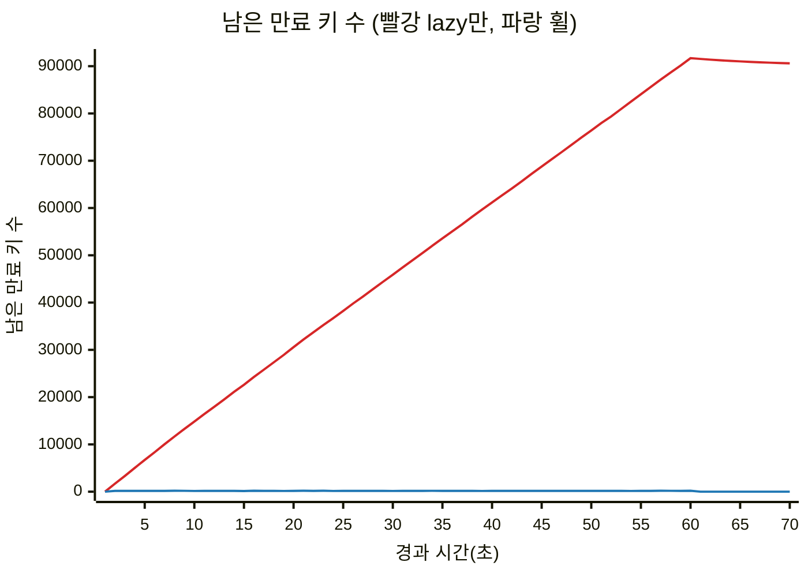
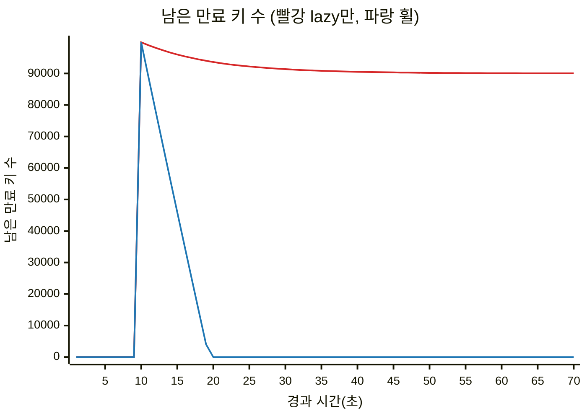

# 만료 회수 측정 결과

키 100,000개를 t=0에 저장, 70초 동안 가짜 시계로 100ms씩 진행.
휠은 tick당 최대 1,000개. 두 방식 모두 핫 키 10%에 tick마다 EXISTS 100번(시드 21).
표본은 1초마다 tick 직전에 뜬다. `python -m bench.expiry_reclaim`이 이 파일과 CSV를 다시 만든다.

| 시나리오 | 방식 | 최대 | 평균 | 끝(70초) | tick 최대(ms) |
| --- | --- | ---: | ---: | ---: | ---: |
| spread | lazy만 | 91,690 | 52,803 | 90,606 | - |
| spread | 휠 | 196 | 144 | 0 | 11.6 |
| burst | lazy만 | 99,901 | 79,919 | 90,028 | - |
| burst | 휠 | 99,901 | 7,369 | 0 | 78.8 |

tick 최대(ms)는 이 컴퓨터의 벽시계 값이라 돌릴 때마다 조금씩 다르다. 나머지 숫자는 결정적이다.

## spread: TTL 1~60초에 고르게

## burst: 10초에 전부 만료 (tick 상한에 걸림)

